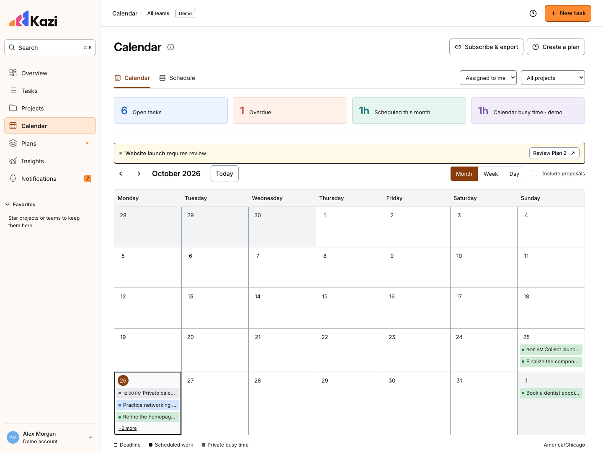

# Kazi

Tasks, projects, and work schedules in one application. Built from [MASTER_PROMPT.md](MASTER_PROMPT.md), which is preserved unchanged.



## Open it locally

Use Node 24 LTS (`app/.nvmrc` pins the supported major version).

```sh
cd app
npm ci
npm run dev
```

Open **http://127.0.0.1:5173**. Without service environment variables, Kazi starts a clearly labeled **synthetic local demo**. Its data persists in this browser. It includes projects, team assignments, an overdue task, a Plan 2 proposal, and example calendar availability. It does not connect to an account or calendar. Settings → Data & app resets the demonstration.

The interface uses black text, clear dividers, and the full content width. One Kazi environment contains all projects. **Overview** owns Calendar and Schedule, with Month, Week, and Day ranges. **Tasks** owns List, Board, and Archive views with project, person, stage, label, and deadline filters. Work outside a named project goes into **Personal planning**. The workflow is Backlog → To do → In progress → To validate → Completed; blocked, rejected, and discontinued work moves into Archive and can be restored to Backlog. Columns scroll independently, cards use worker avatars, and task details open as a full page with the description immediately below the title. The same task record powers every global and project view.

Projects have a separate lifecycle: Planned, In progress, On hold, and **Delivered**. Their Timeline tab shows planned task starts, deadlines, milestones, dependencies, and date conflicts. Delivery does not silently complete tasks. The sidebar’s collapsible **Favorites** contains only your starred projects. Account settings, people, and connections appear under your avatar. Colored task labels and project colors remain consistent across views. See [workflow and timeline](docs/WORKFLOW.md), [accounts](docs/ACCOUNT.md), and [design](docs/DESIGN.md).

**Reports** tracks completion throughput, on-time/late delivery, work in progress, mean/median stage duration, configurable aging thresholds, median lead/cycle time, previous-period comparisons, planned calendar allocation, project goals, explicit milestones, and CSV export. Status changes and calendar plans supply the data automatically; no worked-minute entry is required. See [Reports](docs/REPORTS.md) for metric definitions and coverage.

**Local Convex is available without a cloud account:** run `npm run backend:local` in one terminal, wait for port 3210, then `npm run dev:local` in another. The app at port 5173 uses its durable local database and a loopback-only development session. See [local development](docs/LOCAL_DEVELOPMENT.md). The isolated browser-storage demo runs with `npm run dev:demo` at port 5175.

The app includes task capture, Personal planning, project list and drag-and-drop board, accountable owners, subtasks, dependencies, progress and comments, search and filters, weekly allocation alternatives, capacity explanations, plan review and comparison, preserved versions/iterations/attempts, explicit reservation release, team invitations, personal planning policy, notifications, data export, and install/update/offline UI.

`app/convex/` contains the real persistence and authorization services, scheduled reminder/recovery jobs, a native Kazi agenda with revocable ICS subscriptions, optional Google free/busy reads, a legacy external-write reconciliation outbox, and authenticated remote MCP. UI data actions and MCP share validation, authorization, and commands. **Kazi is hosted at [kazi.iyanju.com](https://kazi.iyanju.com)** with production Clerk and Convex. Cloudflare hosts its DNS, and development previews use isolated backends. Local Convex remains available separately. GitHub CI and the hosted sign-in page have been verified; see [verification status](docs/TEST_REPORT.md) for the remaining real-account and optional integration checks.

## Connect Clerk and Convex

1. Create or select an authorized Clerk application. Enable its **Convex integration** and copy its issuer domain. Do not enable Clerk Organizations or billing; Kazi stores its own memberships.
2. From `app/`, run `npm run backend` (`convex dev`). Select your intended development project on the **hard-capped Free plan**. The CLI refreshes the canonical `convex/_generated/` bindings and deployment configuration. Generated bindings are included so tests and local demo builds work before account setup.
3. Create `app/.env.local` using `.env.example` as the checklist:

```dotenv
VITE_CLERK_PUBLISHABLE_KEY=pk_test_YOUR_KEY
VITE_CONVEX_URL=https://YOUR_DEPLOYMENT.convex.cloud
```

4. Set backend variables on the development Convex deployment:

```sh
npx convex env set CLERK_JWT_ISSUER_DOMAIN 'https://YOUR_INSTANCE.clerk.accounts.dev'
npx convex env set APP_ORIGIN 'http://127.0.0.1:5173'
```

`CONVEX_SITE_URL` is supplied by Convex automatically. Set `INVITATION_SIGNING_KEY` to at least 32 cryptographically random characters through the Convex dashboard. Never place backend secrets in a `VITE_` variable. Both browser variables are required for live mode; partial configuration displays a repair screen.

5. Restart `npm run dev`, sign in, and create your first task. Onboarding transactionally creates a personal environment and Personal planning project. Kazi agenda is ready without Google consent.

Keep `npm run backend` running during development. Inspect **Functions → Scheduled functions**, **Data**, and **Logs** in the selected Convex dashboard. See [operations](docs/OPERATIONS.md) for job recovery and backup.

## Start using Kazi

- **First task:** New task or press `N`. Enter a title and optional estimate/deadline. Omitting a project routes it to Personal planning. `⌘/Ctrl K` opens search.
- **People:** Account → Team & people → Create team, or select an existing team, then invite an email address with a role and project access. Creators manage their team; one person can belong to several teams. The global team filter scopes tasks, projects, calendar, and reports. Optional Resend delivery shows queued/sent/failed status; expiring signup links also work without email configuration.
- **A week:** Open Plans → New proposal, review alternatives, and approve your sessions in Kazi agenda. Optional Google availability reads help avoid outside meetings. Publish a private calendar link from Connections → Calendar to subscribe in Google, Outlook, or Apple Calendar.
- **Task categories:** Add comma-separated labels such as Research, Design, Development, or Admin when creating or editing a task. Colors stay consistent across tasks. Filter them in Tasks.
- **Favorites:** Star or unstar projects in the project list or project details. Only your active starred projects appear in the collapsible Favorites section; favorites are saved per account.
- **Recovery:** Review the pending proposal in Plans → Proposals. Approval binds the displayed revision and creates the next numbered version once. Original deadlines and previous accepted snapshots remain preserved under Plans → History.
- **Automatic recovery:** Settings → Planning → turn **Review new plans before scheduling** OFF and save deliberately. Eligible recovery runs within your saved limits. Each teammate retains their own authority, and project review requirements can make policy stricter.
- **Reports:** Open Reports, choose a period/person/project, and switch between Workload, Performance, Workflow, and Goals. Project colors match the calendar.
- **Calendar and MCP:** Kazi publishes your own agenda through a private ICS link. A public HTTPS backend is needed for remote subscribers; provider refreshes are delayed and cannot guarantee immediate booking protection. Follow [calendar setup](docs/CALENDAR.md) and [assistant setup](docs/MCP.md). Calendar and MCP do not require an AI key or email provider.

## Development data

The local demonstration seeds itself. To create a separate synthetic workspace on a configured **development** Convex deployment:

```sh
npx convex env set ALLOW_SYNTHETIC_SEED true
npm run seed -- '{}' --identity '{"subject":"YOUR_CLERK_USER_ID","name":"Developer","email":"developer@example.test","emailVerified":true}'
npx convex env remove ALLOW_SYNTHETIC_SEED
```

The seed becomes part of the development identity’s authorized team data on the next page load. Seed calendars contain no provider credentials and no external writes occur. Use your actual immutable Clerk subject only on an authorized development deployment; the CLI identity option is administrative testing functionality. Do not enable synthetic seeding on production.

## Verify

```sh
cd app
npm run typecheck
npm test
npm run build
npx playwright install chromium
npm run test:e2e
npm run benchmark
npm audit
npm run format:check
npm run check:deploy
```

On this Mac, Playwright’s bundled headless-shell screenshot command stalled even on a blank page; installed Chrome worked. Use `KAZI_TEST_BROWSER=chrome npm run test:e2e` if needed. The suite runs dev and production preview servers automatically; keep ports 5175 and 4173 free. The developer app remains separate on 5173. Browser tests use synthetic data only. The Python visual walkthrough in `app/tests/walkthrough.py` uses installed Chrome and a running dev server.

## GitHub and Vercel

The repository is [bolablg/kazi-app](https://github.com/bolablg/kazi-app), linked to the [Kazi Vercel project](https://vercel.com/bolablg-projects/kazi-app). Work on `dev-bola`, promote by pull request to `staging`, then promote `staging` to `main` for production at `kazi.iyanju.com`. CI checks both promotion steps, including browser and PWA tests. See [release workflow](docs/RELEASES.md) for environment isolation, deployment configuration, and rollback.

`npm run build:vercel` deploys the matching Convex backend and builds the frontend using its injected URL. It requires properly scoped Clerk and Convex credentials and rejects local/demo authentication. Cloudflare continues to host DNS; Vercel hosts the frontend. The older Cloudflare deployment commands remain available as an alternative.

## Alternative Cloudflare hosting

Follow [deployment](docs/DEPLOYMENT.md). After explicit deployment authorization and account/free-plan verification:

```sh
cd app
npm run deploy:backend
# Configure the production Clerk issuer and production backend secrets.
# Set VITE_CONVEX_URL and VITE_CLERK_PUBLISHABLE_KEY=pk_live_... for the build.
npm run deploy:frontend
```

The frontend deployment command checks for production Clerk/Convex configuration. Cloudflare Workers Static Assets serves `app/dist/` directly, with SPA fallback. Domain binding and production Google redirect configuration remain explicit review steps. No domain is hardcoded or transferred.

## Documentation

| Guide                                              | Contents                                                                   |
| -------------------------------------------------- | -------------------------------------------------------------------------- |
| [Architecture](docs/ARCHITECTURE.md)               | Data model, trust boundaries, transactional application, immutable history |
| [Product and permissions](docs/PRODUCT.md)         | Roles, Inbox, estimates, team privacy, recovery behavior                   |
| [Local development](docs/LOCAL_DEVELOPMENT.md)     | Durable local Convex, development session, separate demo/test server       |
| [Resource IDs](docs/RESOURCE_IDS.md)               | Opaque identity, canonical links, migration and historical references      |
| [Reports](docs/REPORTS.md)                         | Time use, completion metrics, achievements, dated history and CSV exports  |
| [Calendar](docs/CALENDAR.md)                       | OAuth, scopes, free/busy, incremental sync, troubleshooting                |
| [MCP](docs/MCP.md)                                 | Tokens, tool contracts, clients, approval links, examples                  |
| [Operations](docs/OPERATIONS.md)                   | Jobs, retries, backup, restoration, deletion, quota response               |
| [Deployment](docs/DEPLOYMENT.md)                   | Exact hosted-stack setup, checked allowances, launch gates                 |
| [Test report](docs/TEST_REPORT.md)                 | Actual checks, acceptance coverage, external gates and limits              |
| [Implementation decisions](docs/IMPLEMENTATION.md) | Assumptions and build plan                                                 |
| [Third-party notices](docs/THIRD_PARTY.md)         | Direct dependencies and licenses                                           |

Application source is MIT licensed. Dependencies retain their own licenses. No billing, advertising, mandatory analytics, paid organization features, or hosted AI inference is configured.

Task owners and workers can differ. Submission notifies the owner; approval completes work, while return requires a reason and notifies the worker. **To Brainstorm** retains backlog ideas with review dates. Every task/project change appends immutable timestamped history for stage-duration analytics. All these data actions are available through the same authorized MCP services. See [workflow](docs/WORKFLOW.md) and [team/email setup](docs/ACCOUNT.md).
