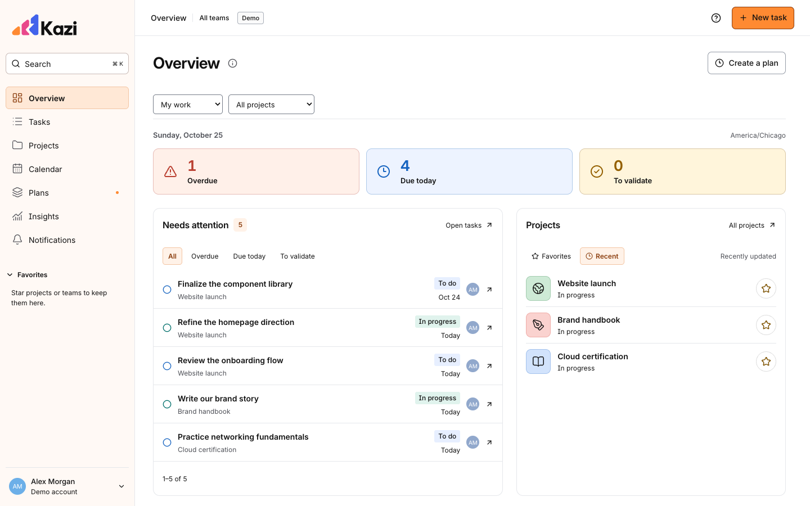

<picture>
  <source media="(prefers-color-scheme: dark)" srcset="app/public/brand/kazi-logo-dark.svg">
  
</picture>

Work management for people, teams, and agents.

Kazi brings tasks, projects, planning, and performance insights into one place. Capture what needs doing, decide who owns it, plan when to work on it, and follow it through to completion.

**[Open Kazi](https://kazi.iyanju.com)** · [Connect an agent](docs/MCP.md) · [Product guide](docs/PRODUCT.md)

## Manage the work

Use lists and drag-and-drop boards to move tasks through **Backlog → To do → In progress → To validate → Completed**. Keep rejected or discontinued work in Archive, and save ideas for a later review with **To Brainstorm**.

Group work into projects, or use Personal planning for everyday tasks. Add priorities, colored tags, deadlines, dependencies, subtasks, and milestones. Project timelines show how the pieces fit together. Favorites keep the projects and teams you use most within reach.

## Collaborate with clear responsibilities

Each task has an owner and a worker; they can be the same person. Workers submit work for validation. Owners approve it or return it with a reason. Comments, files, links, and timestamped activity keep the discussion and decisions with the task.

Choose Personal or a team when capturing work. Find owners, workers, and collaborators by name, username, or email. Use @mentions in descriptions and comments to bring the right teammates into the task and notify them.

Create teams, invite people, and control access to projects. If you belong to several teams, use the team filter to focus on the work you need to see.

## Plan your day, week, and month

**Overview** opens directly on your daily priorities, work ready to start, favorite and recent projects, and recent task activity. **Calendar** has Calendar and Schedule views for seeing when work happens. **Plans** keeps proposals and accepted plan history together.

The agenda combines deadlines and scheduled focus sessions in daily, weekly, and monthly views. Review proposed plans before accepting them, adjust your working hours and capacity, and keep previous plan versions when priorities change.

Open **Calendar → Subscribe & export** to publish a private calendar subscription to view your Kazi agenda in Google Calendar, Outlook, Apple Calendar, or another compatible calendar app.

## Understand how work moves

**Insights** shows completed work, on-time and late delivery, work in progress, stage durations, aging tasks, planned focus allocation, and progress toward project milestones. Filter by team, person, project, or period, and export daily totals.

These insights come from task changes and plans. You do not need to log hours. Scheduled time describes your plan; it is not a measurement of hours worked or a productivity score.

## Use Kazi through MCP

Developers and agents can read and manage work through Kazi's MCP server. Create tasks and projects, update stages, post comments, attach artifacts, propose plans, and retrieve reports using the same permissions and validation as the app.

Connect to **`https://kazi.iyanju.com/mcp`**. Open **Account → Connections → MCP & agents** to create a scoped, revocable credential. **Copy agent setup** gives you a guide to paste into your chosen agent, including that connection's key and permissions. You control which actions each connection can perform, including whether it may approve plans. The [MCP guide](docs/MCP.md) covers connection details, scopes, and tool contracts.

## Current boundaries

- Calendar subscriptions publish Kazi's agenda outward. Changes made in another calendar do not update Kazi, and refresh timing depends on that calendar provider.
- Task review and other work notifications appear in the app. Invitation email delivery depends on the configured email service; shareable invitation links are also available.
- The app can be installed on supported phones, tablets, and desktops. Accessing private account data and saving changes requires a connection.
- The Insights page describes recorded workflow events, estimates, and planned allocation. It does not monitor activity or infer business outcomes from task counts.

## Guides

| Guide                                  | What it covers                                                |
| -------------------------------------- | ------------------------------------------------------------- |
| [Tasks and projects](docs/WORKFLOW.md) | Stages, ownership, review, dependencies, files, and timelines |
| [Accounts and teams](docs/ACCOUNT.md)  | Your account, invitations, roles, and project access          |
| [Product behavior](docs/PRODUCT.md)    | Planning, permissions, notifications, and offline behavior    |
| [Insights](docs/REPORTS.md)            | Metric definitions, history, coverage, and exports            |
| [Calendar](docs/CALENDAR.md)           | Private subscriptions and availability                        |
| [MCP](docs/MCP.md)                     | Agent connections, scopes, tools, and examples                |
| [Resource links](docs/RESOURCE_IDS.md) | Stable task and project identifiers                           |

Kazi's source is available under the [MIT license](LICENSE). See [third-party notices](docs/THIRD_PARTY.md) for dependency licenses.
