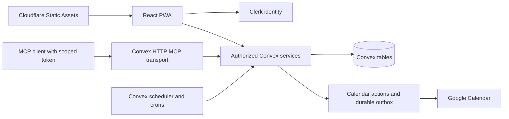

# Architecture and data model

## Runtime and trust

React/Vite runs in the browser. Cloudflare serves static assets. Clerk supplies immutable user identity. Convex validates Clerk’s issuer and `convex` audience, authorizes every workspace/domain operation, stores data, and executes durable scheduled work. Google Calendar is called only from Convex actions. The official MCP SDK runs through a stateless web-standard Streamable HTTP transport in a Convex HTTP action; a second Worker/server is unnecessary for this SDK version.

`src/data.tsx` selects the connected adapter only when both public environment variables exist. `DemoProvider` uses synthetic fixtures and the same command/domain engine. Demo writes simulate a provider receipt and never call real services. `shared/domain.ts` is the common policy/validation layer used by Convex and fixtures. `shared/scheduler.ts` contains provider-independent deterministic TypeScript allocation.

## Schema

`app/convex/schema.ts` and `validators.ts` validate stored documents. Kazi uses stable application keys for public business identity and native `v.id()` references for tenant, project/task, version/attempt, and iteration relationships. The storage adapter resolves native references inside the same transaction. A project or task key from another workspace cannot satisfy a scoped indexed lookup.

| Tables                                              | Responsibility                                                                                                              |
| --------------------------------------------------- | --------------------------------------------------------------------------------------------------------------------------- |
| `profiles`, `workspaces`, `memberships`             | Clerk subject mapping, personal/team scope, roles, default Personal planning project, per-person planning constraints       |
| `projects`, `tasks`                                 | Stable containers, ownership, subtasks, dependencies, effort, original deadlines, revisions and meaningful progress         |
| `invitations`                                       | Recipient, role, intended projects, token hash, expiry/revocation/acceptance                                                |
| `proposals`                                         | Current revision, alternatives, approvals, task revisions, availability watermark, reproducible inputs, application receipt |
| `versions`                                          | Immutable accepted task/session/input snapshots, monotonically allocated version number, lineage and predecessor            |
| `iterations`, `attempts`                            | Project execution cycles and linked attempts on canonical tasks                                                             |
| `calendarStatuses`, `busy`                          | Selected calendars, destination, opt-in free/busy sharing, connection health and authorized busy intervals                  |
| `calendarSecrets`, `oauthStates`, `calendarCursors` | Encrypted refresh credentials, single-use OAuth state, incremental sync/page cursors and due times                          |
| `activities`, `notifications`                       | Append-only important-action attribution, comments/progress/policy events, deduplicated in-app delivery                     |
| `outbox`, `idempotency`, `rateLimits`               | Durable provider intents/receipts/retries, caller retry keys, bounded expensive operations                                  |
| `mcpTokens`, `mcpActivity`                          | Hashed scoped credentials, reported client metadata, bounded personal tool activity                                         |

Comments and progress entries are typed activity records. Notifications are in-app delivery records, with `deliveryAt` representing quiet-hours deferral; no external delivery is implied. Accepted versions carry root lineage IDs, so a separate plan identity remains stable across numbered versions.

## Reads and writes

`commands.snapshot` derives the actor from Clerk, checks membership, loads indexed workspace records, and filters private projects, task references, history, recipient notifications and calendar data. Guest visibility is restricted by project membership. The client never supplies its authoritative actor ID.

`commands.execute` accepts a JSON command parsed by the shared Zod discriminated union and a stable request ID. Domain rules validate relationships and permissions. Changes, activity and idempotency records commit atomically. A native workspace-scoped key lookup prevents client retries from duplicating work. Convex optimistic concurrency retries the transaction if a competing mutation invalidates its read set; indexes are not treated as SQL uniqueness declarations.

Planning and approval use dedicated actions. Fresh authorized free/busy is fetched before the internal mutation. Actions cannot trust their earlier caller state; internal functions resolve the stored actor and current membership. Scheduling constraints and task revisions are rechecked, and the current review policy is consulted again at provider-write time.

## Plan lifecycle and invariants

1. Proposal generation produces alternatives and reproducible inputs without provider writes or accepted version numbers.
2. Alternative selection increments the revision and clears approvals. Rejection does not consume a number.
3. Calendar owners approve the exact current revision. Team portions wait until all affected owners approve, or each satisfies explicit automatic policy.
4. Acceptance checks current tasks, constraints, predecessor, conflicts and policy. The next version, iteration, task attempts, and stable outbox intents are created transactionally once.
5. `jobs.write` reconciles the deterministic Google event ID in the original pinned destination calendar, rechecks current authority and fresh availability, then creates a personal event with no attendees. A later destination selection cannot redirect an accepted write. Every success/failure updates only the current receipt/projection.
6. A timeout after creation is retried by GETting the same ID first. Concurrent POSTs converge on the same provider ID; a 409 is verified against Kazi’s private ownership marker. Successful events are not blindly deleted as compensation.
7. Incremental Google changes update the current projection and notify the owner, while `versions` retains the original schedule snapshot.
8. Releasing selected future reservations is a separate owner-authorized action. It verifies the actual event ownership and future start before DELETE, preserves history, and records a release receipt.

States include awaiting review, applying, applied, partial, rejected, stale and failed. Versions are immutable; external status and supersession are represented through later version links, receipts and activity. The data store refuses to replace accepted versions or remove historical versions, iterations, attempts or activity during ordinary commands.

## Allocation rules

Instants use UTC milliseconds; local intent uses IANA zones and Temporal. Date-only deadlines end at the following local midnight. Ambiguous/nonexistent working-hour boundaries are rejected with a repair message. Intervals from several selected calendars are unioned through subtraction; buffers, dependency order, daily capacity, working days, min/max session length, and the planning horizon constrain allocations.

Only leaf tasks contribute effort. Remaining minutes take precedence over initial estimates and logged time. Blocked, unknown-estimate and unassigned work is explained rather than silently scheduled. Backlog, To validate, Completed, and archived tasks are excluded from allocation. Old future events continue blocking availability; recovery does not grant authority to release them. A recovery target never rewrites the original deadline.

## Bounded initial rollout

The current UI uses one aggregate subscription for up to ten authorized teams, rather than an unbounded per-task subscription. Entity reads are capped at 1,000 records per table; activity projection shows 200 records while older activity remains stored. MCP list tools paginate the authorized bounded projection. This is deliberately an early-testers implementation, not a claim of efficient support for 1,000 users or arbitrarily large workspaces. Before expansion, replace the aggregate projection with indexed per-screen cursor pagination and measure database I/O, which is likely the binding free-plan constraint.

Reminder reconciliation selects one due workspace per minute. Calendar metadata reconciliation selects at most three due connections per minute and processes one provider page per action, with retry/backoff. Planning is limited to ten previews per actor/workspace per 15 minutes. These operational bounds never activate paid capacity.

## Single application interface and overview

The browser combines up to ten authorized memberships through `commands.allSnapshot` and `mergeTeamStates`. A global team filter chooses one or all; resource-to-team mappings route every write to its own scoped command service. Membership roles remain separate even for the same person. `createTeam` makes the caller manager; `enableCollaboration` still shares an existing personal scope in place. Bootstrapping falls back to an accessible membership if the last active team was removed.

Before preview/approval, a mutation reads the caller's reservations in their other teams and adds title-free busy intervals to planning inputs. Concurrent approvals share those read dependencies, so a competing committed reservation invalidates the other approval. Accepted inputs preserve that availability evidence.

`shared/overview.ts` builds a read-only calendar/schedule projection from authorized tasks, current proposal receipts, accepted snapshots when no current receipt exists, and the actor's free/busy intervals. Due dates are distinct from time reservations. Released sessions are excluded, current receipts supersede history, overlapping intervals merge per calendar owner, and cross-midnight spans are split by local day boundaries. The projection does not mutate plans, tasks, or provider data. `src/OverviewPage.tsx` provides calendar/schedule date, project, and person filters. Tasks owns the list and board views.

## Native agenda and API parity

`shared/capabilities.ts` exhaustively maps each command to its MCP permission; tests assert every command has a mapping. `mcp/server.ts` generates named tools from the same Zod command union and exposes `execute_action`. `convex/http.ts` derives the actor from a hashed credential and delegates to the same commands, calendar, reports, collaboration, and credential services used by React. Read models include timeline, agenda, current settings, paginated report facts, report JSON/CSV, and export. No second business-rule implementation or REST endpoint per button is needed.

Native acceptance sets Kazi sessions to scheduled in the same transaction. Pending external sessions alone create outbox intents. Native release updates the receipt and preserves `versions`; task status changes release future native sessions when execution stops. Acceptance deep-clones task/input snapshots so browser demo edits cannot mutate history through object aliasing.

`calendarFeeds` stores per-owner hash-only subscription capabilities, project/deadline filters, expiry, and revocation. The `/agenda/<secret>.ics` HTTP query rechecks current membership and project visibility and renders the authorized current receipt with `shared/ical.ts`. Only assigned sessions are published, never outside event details. OAuth and verified identity/password steps remain provider/browser operations with explicit links; MCP cannot assert verification by supplying text.

## Review, lifecycle analytics, and invitation delivery

Task `ownerId` is the reviewer; `assigneeId` is the worker. Shared `review_task` rules check owner/admin authority, require a return reason, and change status plus notifications transactionally. Workers cannot take review ownership or complete another owner's work through ordinary field updates.

`lifecycleEvents` stores append-only task/project changes with indexed time and entity lookups. It is independent of `reportEvents` completion facts and the 200-item activity projection. Known transition intervals produce mean/median stage durations; To Brainstorm and review thresholds affect current aging insights without adding a board column.

`invitationOutbox` pins email content and tracks leases, bounded attempts, due retries, and delivery status. Optional Resend sends from an action with a stable idempotency key. Every claim checks the pending invitation and manager authority. Scheduled reconciliation picks up expired leases; provider errors never create membership.
