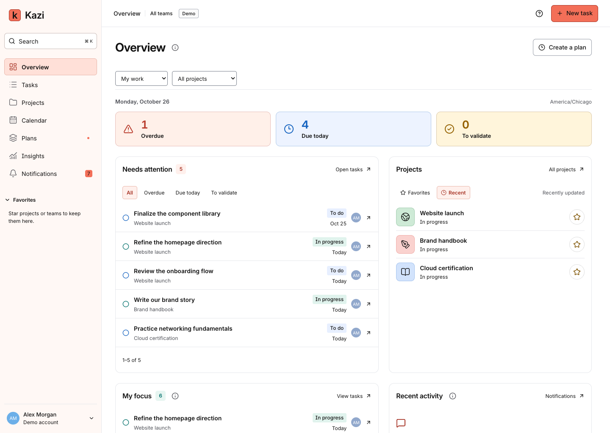
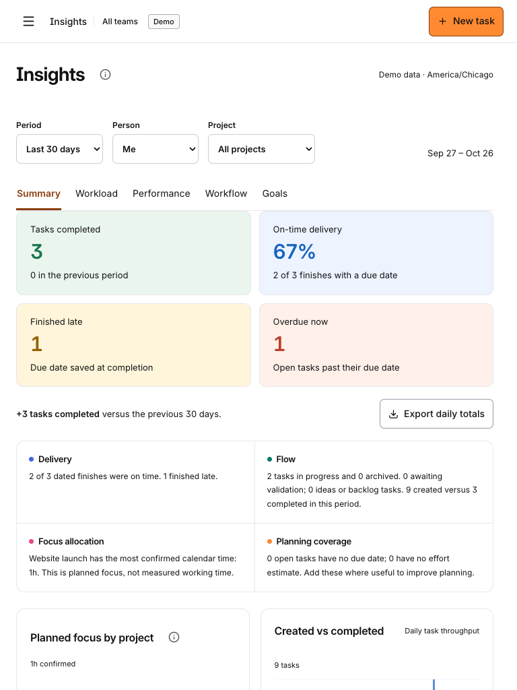
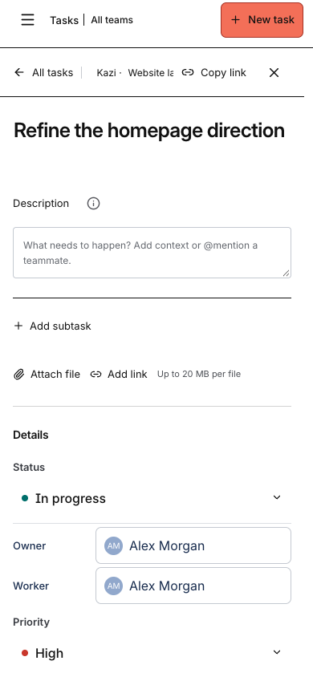
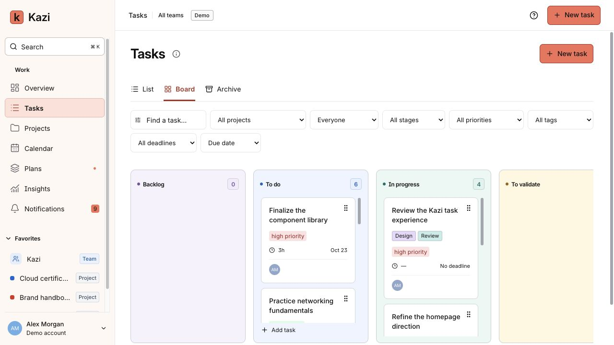
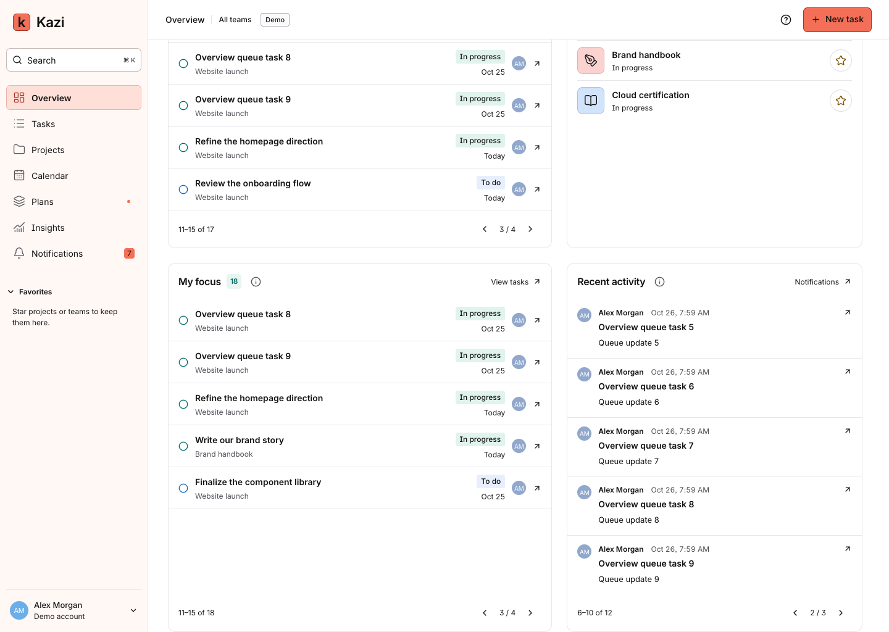
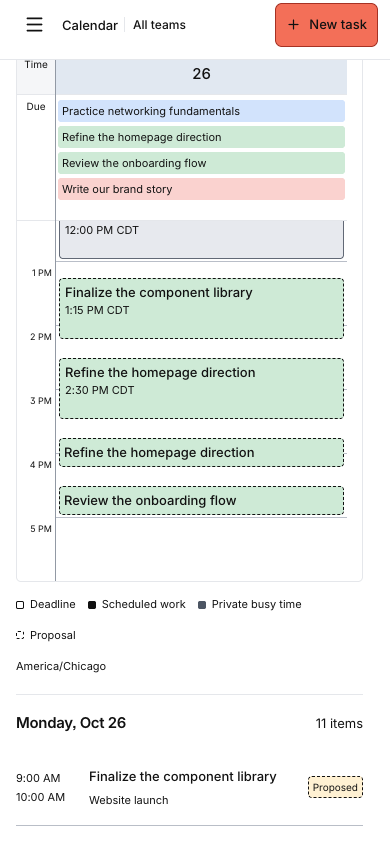
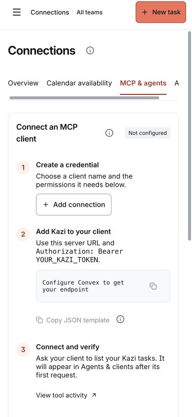
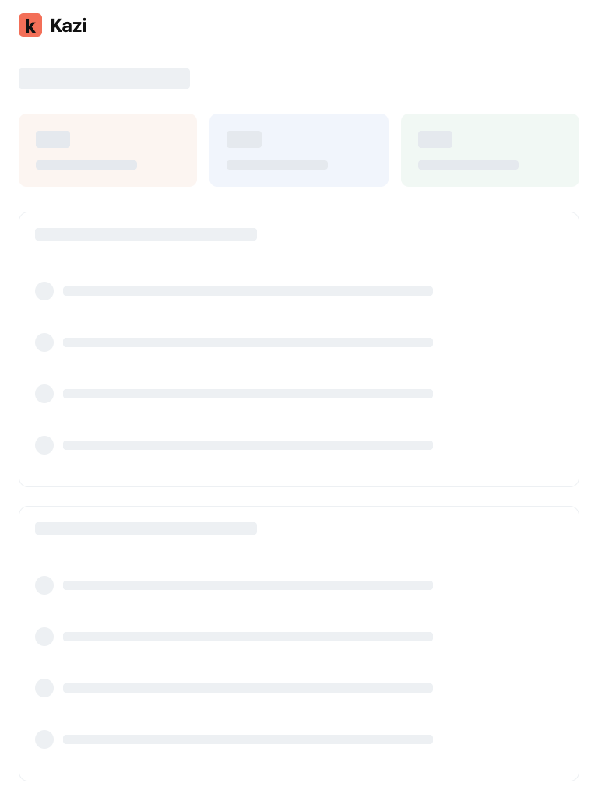

# Interface QA

Review date: October 25, 2026.

Kazi uses a shared, flat interface with coral as the primary action color, black text, and distinct colors for task status, priority, tags, and projects. Desktop Overview, mobile task, and tablet Insights references were developed with Stitch, then adapted to Kazi’s existing navigation and workflows. Generated design explorations remain local; the screenshots below show the implemented app.

## Changes checked

- Full-width pages with a desktop sidebar and a navigation drawer on smaller screens.
- Consistent headings, aligned icons, compact task rows, and bounded board/table scrolling. Spacing and typography separate page and section headings; light neutral dividers remain where they guide dense lists, tables, and calendar grids.
- No application box shadows, text shadows, drop shadows, background blur, offset edges, or thick decorative side/top borders on cards and buttons. Keyboard focus uses an outline inside the control.
- Optional explanations beside relevant headings use an ⓘ button. Bubbles support hover, keyboard focus, click to keep open, Escape, and outside-click dismissal. Their position stays inside the viewport.
- Essential field labels, user content, errors, scheduling consent, and report coverage remain visible.
- Phone task filters expand on demand and retain selections when collapsed or resized. Active filters remain indicated.
- Touch controls and editable mobile text have dedicated sizing; mention text and its highlighting overlay use the same font size.
- Calendar selection retains a visible outline after removing its former inset shadow.

## Coverage

| Check | Coverage |
| --- | --- |
| Broad layout regression | 360, 390, 768, 1024, 1440, and 1920 px |
| Detailed flat-surface and clipping audit | 35 routes at 390, 768, and 1440 px; 105 route/viewport combinations |
| Screen families | Overview, task List/Board/Archive, projects and project views, full task, Calendar month/week/day, Schedule, subscriptions, all five Insights tabs, Plans/history, account/planning/general/data settings, Connections tabs, teams/people, Favorites, and notifications |
| Interaction checks | Help bubbles, filter persistence, dialogs, priority menus, keyboard navigation, task editing, drag and drop, mentions, comments, attachments, plan approval, calendar navigation, and PWA offline/update flows |
| Manual visual review | Overview, task board, full task, and Planning settings in the browser; phone and tablet implementation screenshots |

Automated checks inspect rendered elements and pseudo-elements for shadows, even border widths on cards and actions, page-level horizontal overflow, and clipped header actions. Source checks reject new shadow and blur declarations. Additional assertions check mobile filter touch sizes and readable form text.

The review caught a mobile Filters button inheriting a 40 px desktop height; it now has a 44 px minimum. Tablet Insights metrics now use two columns. Narrow Insights navigation keeps readable tab labels in a bounded scroll area, brings the active tab into view, and supports arrow/Home/End keys. Legacy shadows and decorative edges were removed, including the outer focus ring previously appearing on a newly opened full task page.

## Implementation screenshots

## Validation and limits

The initial modernization passed 173 unit/backend tests, three deployment guards, the production build, formatting, the 105-combination interface audit and overlay checks, and all four Insights regression tests. The initial release ran 59 browser/PWA tests before each promotion through staging to production. Browser tests use isolated synthetic data and do not alter personal production records.

Viewport checks run in Chromium. They do not replace testing on physical iOS/Android devices or every browser engine. The deployed Clerk sign-in page was separately reviewed; provider inputs and social sign-in buttons now have explicit flat borders and 44 px control heights. The synthetic demo cannot verify account-provider behavior, so hosted authentication and account pages also need live checks.

## Calendar, Overview, and refresh follow-up

- Empty month-cell and timed-day areas select the complete day agenda below the calendar. Date buttons retain keyboard support and task entries still open the task.
- Short proposals show a single title line that fits their duration. Tests measure title bounds inside the event at 390, 768, and 1440 px in Week and Day. Screenshots include the previously clipped short sessions.
- Needs attention, My focus, and Recent activity each have independent five-item pagination, exact ranges, clamped last pages, and reset on person/project scope changes. The same pagination is available through MCP. My focus and Recent activity share a desktop grid row and bottom edge.
- Project shortcuts use compact colored icons, names, statuses, and favorite controls. The redundant Work sidebar heading is removed.
- MCP retains credentials, client visibility, and activity. A three-step setup explains credential creation, HTTP configuration, and verification, with a placeholder JSON template and an explicit warning when copying a configuration containing a newly created token.
- HTML renders an identity-free skeleton before JavaScript. Clerk, Convex verification, and the initial data read use the same skeleton. The initial authenticated read runs alongside bootstrap. The skeleton follows the tablet/phone navigation breakpoint, and private data is never persisted for a loading preview.

The follow-up passed 176 unit/backend tests, three deployment guards, build/format checks, the full 66-test browser/PWA suite, and nine final focused browser cases. The final suite has 68 browser/PWA tests, including delayed-script first-paint checks at all three viewport sizes. Account-switch tests verify that previous private content disappears and each identity gets a separate Convex cache.

